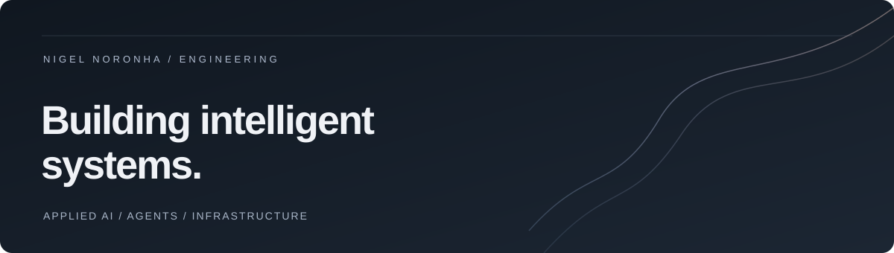

### Nigel Noronha

**AI Engineer · Agentic Systems · Applied AI Infrastructure**

I build useful AI products and the engineering systems that make them reliable.

[Portfolio](https://nigel-noronha.netlify.app) · [Projects](#selected-projects) · [Toolkit](#toolkit)

## What I work on

Agent orchestration, retrieval and knowledge systems, developer tooling, and interfaces that make complex workflows easier to use. I care about clear evaluation, dependable automation, and shipping the whole product.

## Selected projects

| Project | What it does | Built with |
| --- | --- | --- |
| **[StockHub](https://github.com/nin-dev-ai/stockhub-cli)** | Terminal-style financial dashboard with OpenBB data and transparent, rule-based signals. | Python · OpenBB · React · TypeScript |
| **[harness](https://github.com/nin-dev-ai/harness)** | Coordinates Claude Code, Codex, and Cursor in isolated worktrees with shared planning and independent checks. | TypeScript · Node.js · Git |
| **[Codex Loop Harness](https://github.com/nin-dev-ai/codex-loop-harness)** | A reusable, verification-driven Codex development loop with reviewable task branches and persistent state. | Python · GitHub Actions · Codex |

## Toolkit

**Languages & product**

**AI, retrieval & automation**

**Infrastructure**

## Activity

  
  

---

  Based in the UAE · Building at the intersection of AI, systems, and design.

